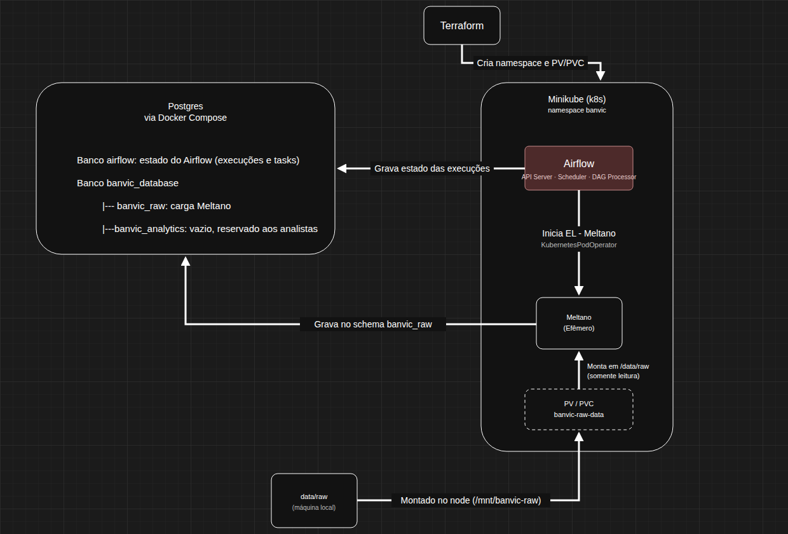

# BanVic Data Platform

Engenharia de dados para o Banco Vitória S.A. (BanVic): ingestão das sete tabelas do ERP em um ambiente centralizado, orquestrado e
reprodutível, pronto para consumo pela equipe de análise.

## Arquitetura



O Terraform cria no Minikube o namespace `banvic`, onde roda o Airflow, e o volume (PV/PVC) que expõe os CSVs de `data/raw`. O diretório
fica fora da imagem: é montado no node do Minikube em `/mnt/banvic-raw`, simulando os arquivos de um sistema legado on-premise. A cada
execução, o Airflow cria um Pod efêmero do Meltano, que monta esse volume somente leitura, lê os CSVs e grava no schema `banvic_raw`. O
PostgreSQL roda fora do cluster, via Docker Compose, e guarda também o estado do Airflow no banco `airflow`.

### Componentes e escolhas

| Componente | Ferramenta | Por quê |
|---|---|---|
| Armazenamento | PostgreSQL 16 (Docker Compose) | Fora do cluster, com volume próprio: os dados sobrevivem à recriação do Minikube. |
| Orquestração | Apache Airflow 3.3.1 no Minikube | API Server, Scheduler e DAG Processor em Deployments separados. |
| Ingestão (EL) | Meltano 4.2.2 (`tap-csv` + `target-postgres`, MeltanoLabs) | Taps/targets declarativos; upsert por chave primária. |
| Execução da ingestão | `KubernetesPodOperator` | Pod efêmero por execução; não há serviço Meltano permanente. |
| Fonte | `data/raw` montado no Minikube (PV/PVC `banvic-raw-data`) | Fora da imagem; trocar os CSVs não exige rebuild. |
| Contêineres | Docker | Imagens `banvic-airflow:3.3.1` e `banvic-meltano:4.2.2` (usuário não root, sem os dados). |
| IaC | Terraform (provider Kubernetes) | Provisiona o namespace `banvic` e o PV/PVC da fonte de dados. |
| Automação | Make | Um comando sobe todo o ambiente. |

## Estrutura do projeto

```text
banvic/
├── airflow/dags/banvic_ingestion.py   # DAG de ingestão
├── data/raw/                          # 7 CSVs do ERP (fonte, montada no Minikube)
├── docker/
│   ├── airflow/Dockerfile             # imagem oficial do Airflow + DAG
│   └── meltano/Dockerfile             # Meltano + plugins (sem os CSVs)
├── docs/arquitetura.png               # diagrama da arquitetura (fonte: arquitetura.html)
├── k8s/
│   └── airflow/
│       ├── configmap.yaml             # configuração comum (sem segredos)
│       ├── auth-secret.yaml           # Secret: JWT da Execution API
│       ├── database-secret.yaml       # Secret: conexão do Airflow com seu banco
│       ├── postgres-secret.yaml       # Secret: conexão com banvic_database
│       ├── rbac.yaml                  # ServiceAccount/Role para criar Pods
│       ├── deployment.yaml            # API Server
│       ├── scheduler.yaml
│       ├── dag-processor.yaml
│       ├── service.yaml
│       └── migrate-job.yaml           # airflow db migrate
├── meltano/csv_files_definition.json  # arquivo → entidade → chaves
├── meltano.yml                        # tap-csv / target-postgres
├── plugins/                           # lock files dos plugins Meltano (gerados por meltano lock)
├── postgres/init/                     # banco airflow e schemas do banvic_database
├── terraform/
│   ├── main.tf                        # provider Kubernetes (contexto banvic)
│   ├── namespace.tf                   # namespace banvic
│   └── storage.tf                     # PV/PVC banvic-raw-data → /mnt/banvic-raw (node)
├── docker-compose.yml                 # PostgreSQL
├── Makefile
├── requirements.txt                   # dependências da DAG (só para o editor)
└── .env.example
```

## Como executar

### Pré-requisitos

- Docker Engine com Docker Compose v2
- Minikube (driver Docker)
- kubectl
- Terraform >= 1.6
- GNU Make

### 1. Configurar as variáveis

```bash
cp .env.example .env
```

Preencha a senha do PostgreSQL e gere o segredo JWT do Airflow:

```bash
openssl rand -hex 32   # valor de AIRFLOW_JWT_SECRET
```

| Variável | Uso |
|---|---|
| `POSTGRES_DB` | Banco do desafio (`banvic_database`) |
| `POSTGRES_USER` / `POSTGRES_PASSWORD` | Usuário do PostgreSQL, usado pelo Airflow e pelo Meltano |
| `POSTGRES_PORT` | Porta publicada pelo Compose |
| `POSTGRES_HOST` | Endereço do PostgreSQL visto do Minikube (`host.minikube.internal`) |
| `AIRFLOW_JWT_SECRET` | Chave da Execution API do Airflow 3 |

O banco interno do Airflow tem nome fixo (`airflow`) e é criado por `postgres/init/init.sql`. O `make run` interrompe a execução se
alguma variável obrigatória estiver vazia.

### 2. Subir o ambiente

```bash
make run
```

Etapas executadas:

1. verifica as dependências e as variáveis do `.env`;
2. sobe o PostgreSQL (Compose) e aplica, de forma idempotente, os scripts de `postgres/init`;
3. inicia o cluster Minikube (perfil `banvic`) montando `data/raw` em `/mnt/banvic-raw` no node, e confere a montagem;
4. constrói as imagens do Airflow e do Meltano e as carrega no Minikube;
5. executa o `terraform apply` (namespace `banvic` e PV/PVC `banvic-raw-data`);
6. renderiza os manifests com as variáveis do `.env`, em memória e sem gravar segredos em disco, e aplica os Secrets, o RBAC e o Service;
7. executa a migration do banco do Airflow e espera ela terminar;
8. aplica API Server, Scheduler e DAG Processor, reinicia os Pods para usar a imagem recém-construída e aguarda os três ficarem prontos.

> A montagem de `data/raw` é definida na criação do cluster. Se o perfil `banvic` já existia sem ela, o `make run` avisa; recrie com
> `make clean && make run`.

Para remover todo o ambiente (cluster, PostgreSQL com seus dados, estado do Terraform e imagens) e começar do zero:

```bash
make clean
```

### 3. Acessar o Airflow

```bash
make airflow
```

Exibe usuário e senha e abre o port-forward em <http://localhost:8080>.

### 4. Executar o pipeline

Pelo terminal (despausa a DAG, se preciso, e dispara uma execução):

```bash
make dag-run
```

Ou pela interface: ative o toggle da DAG `banvic_ingestion` (DAGs novas começam pausadas) e clique em *Trigger*.

### 5. Verificar os dados

```bash
docker compose exec postgres sh -c 'psql -U "$POSTGRES_USER" -d "$POSTGRES_DB"'
```

```sql
SELECT COUNT(*) FROM banvic_raw.transacoes;
```

O histórico das execuções (status, duração e tentativas) fica na UI do Airflow, nas abas *Grid* e *Gantt*, ou no terminal:

```bash
kubectl exec -n banvic deployment/airflow-scheduler -- airflow dags list-runs banvic_ingestion
```

## Estratégia de ingestão

- **Padrão ELT:** os dados são entregues no schema `banvic_raw` exatamente como estão nos arquivos de `data/raw`, sem transformação nem
  validação de conteúdo. Tratamento e regras de qualidade ficam a cargo da camada analítica.

- **Fonte:** os sete CSVs de `banvic_data.zip`, que simulam um sistema legado on-premise, ficam em `data/raw`, fora da imagem. O diretório
  é montado no node do Minikube (`/mnt/banvic-raw`), exposto pelo PV/PVC `banvic-raw-data` e montado somente leitura no Pod do Meltano em
  `/data/raw`. O Meltano lê os arquivos no momento da execução: arquivos atualizados entram na próxima carga sem rebuild da imagem.

- **Extractor (`tap-csv`):** o arquivo `meltano/csv_files_definition.json` declara, para cada arquivo em `/data/raw`, a entidade de destino
  e a **chave primária** (composta em `colaborador_agencia`). O tap entrega todas as colunas como texto, preservando a representação
  original da fonte.

- **Loader (`target-postgres`):** grava no schema `banvic_raw` e usa as chaves primárias para fazer **upsert**. Reexecutar o pipeline
  atualiza registros existentes em vez de duplicá-los. Essa é a garantia de **idempotência**.

- **Carga:** completa a cada execução (*full load* com upsert), adequada ao volume da POC (cerca de 76 mil registros). Exclusões na
  origem não são propagadas; com uma fonte incremental real, o próximo passo seria usar *state* do Meltano ou *soft delete*.

- **Conexão:** o Pod do Meltano recebe `TARGET_POSTGRES_SQLALCHEMY_URL` do Secret `banvic-postgres-connection` (ambiente Meltano `k8s`).

## Orquestração

DAG `banvic_ingestion` (execução manual, `schedule=None`, `catchup=False`):

A DAG tem uma única task, `ingestao_meltano`, do tipo `KubernetesPodOperator`. Ela cria o Pod `banvic-meltano:4.2.2`, monta o PVC
`banvic-raw-data` em `/data/raw` (somente leitura), executa `meltano --environment=k8s run tap-csv target-postgres`, transmite os logs
para o Airflow e remove o Pod ao final.

Não há tasks de controle (início, sucesso ou falha). O Airflow já registra no seu próprio banco o estado, o horário de início e fim,
a duração e as tentativas de cada execução, e o Meltano informa no log quantos registros carregou em cada tabela.

Não há Sensor de arquivos: a disponibilidade da fonte é garantida na subida do ambiente (o `make run` confere a montagem de
`/mnt/banvic-raw` e o PVC só se liga ao PV existente). Se um arquivo faltar, o `tap-csv` falha, a task entra nos retries e a execução
termina como `failed`. Um `FileSensor` não ajudaria aqui, porque roda no Scheduler, que não monta o volume. Se os arquivos passarem a
chegar de forma assíncrona (diretório de entrada ou bucket), um sensor em modo `reschedule` (como o `S3KeySensor`) deve anteceder
`ingestao_meltano`.

## Monitoramento e tratamento de falhas

- **Retries:** a task tem 2 novas tentativas, com intervalo de 1 minuto. Se todas falharem, a execução fica como `failed` no Airflow.
- **Health checks:** o API Server tem *readiness* e *liveness probe* em `/api/v2/monitor/health`; Scheduler e DAG Processor têm *liveness
  probe* com `airflow jobs check`. O Kubernetes reinicia o componente que travar.
- **Histórico de execuções:** estado, início, fim, duração e tentativas ficam no banco interno do Airflow e aparecem nas abas *Grid*,
  *Graph* e *Gantt*.
- **Logs:** a saída do Meltano, inclusive a contagem de registros por tabela, aparece no log da task `ingestao_meltano` na UI do Airflow.
- **Idempotência:** upsert por chave primária no target e `CREATE ... IF NOT EXISTS` nos scripts de banco. Execuções consecutivas
  mantêm as mesmas contagens.

## Segurança e segredos

- Nenhuma credencial é versionada: o `.env` está no `.gitignore` e o repositório traz apenas o `.env.example`.
- Os manifests contêm placeholders (`$(POSTGRES_PASSWORD)`, ...). O Makefile os substitui em memória e envia o resultado direto ao
  `kubectl`, sem arquivos intermediários.
- No cluster, as credenciais existem somente em **Kubernetes Secrets** (`airflow-auth`, `airflow-database` e `banvic-postgres-connection`),
  injetados por `envFrom`. As specs dos Deployments não contêm senhas. A string de conexão do `banvic_database`
  (`banvic-postgres-connection`) vai só para o Pod do Meltano; os componentes do Airflow recebem apenas a do banco `airflow`.
- Na POC, Airflow e Meltano usam o mesmo usuário do PostgreSQL. Em produção, o próximo passo é separar usuários: um com acesso só ao
  banco `airflow` e outro com escrita só no schema `banvic_raw`.
- O Scheduler usa uma ServiceAccount com Role restrita ao namespace `banvic` (Pods, logs e eventos). O Pod do Meltano roda sem token da API
  (`automount_service_account_token=False`), com usuário não root e com os dados de origem montados somente leitura.
